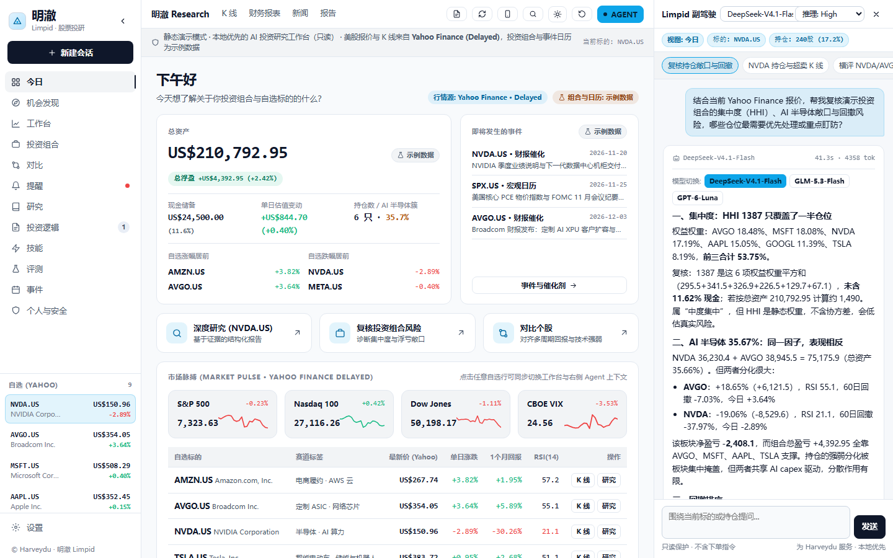
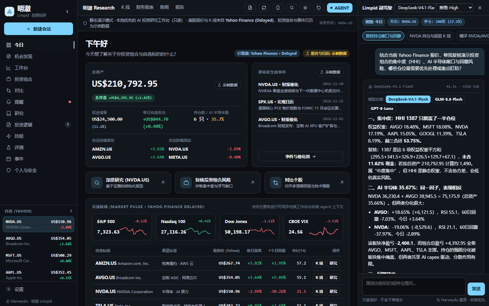
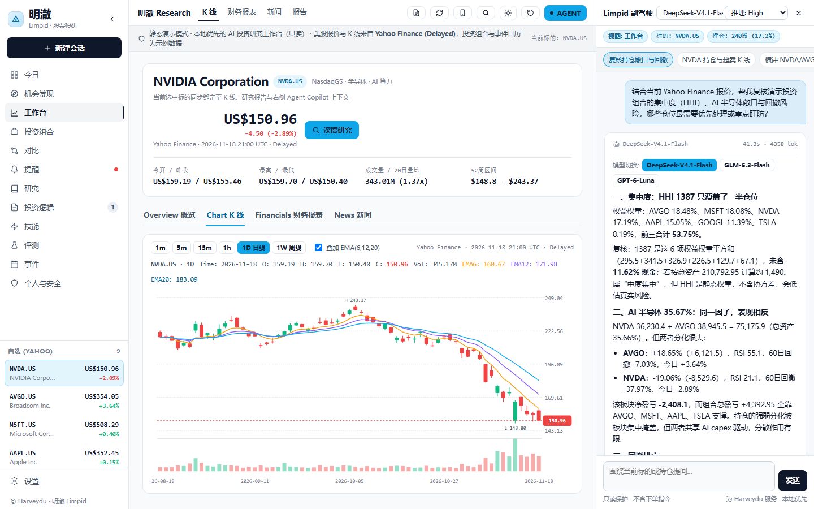
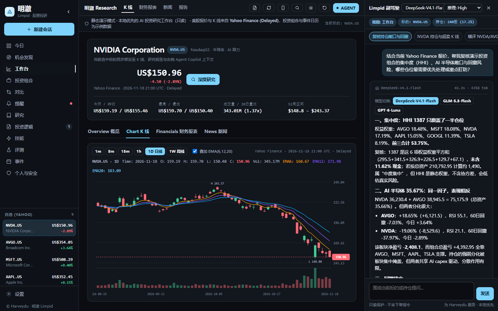
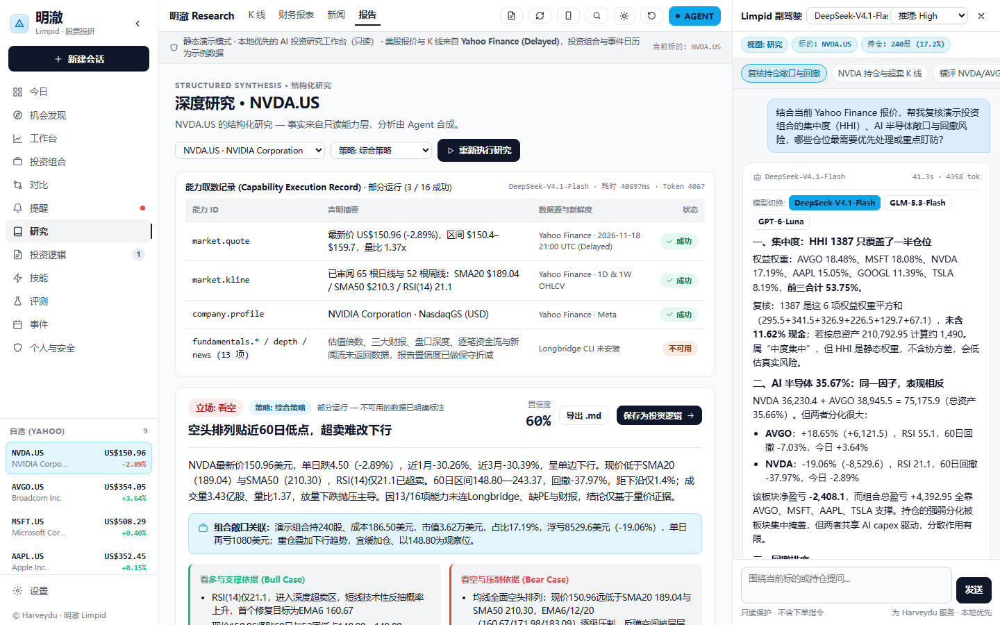
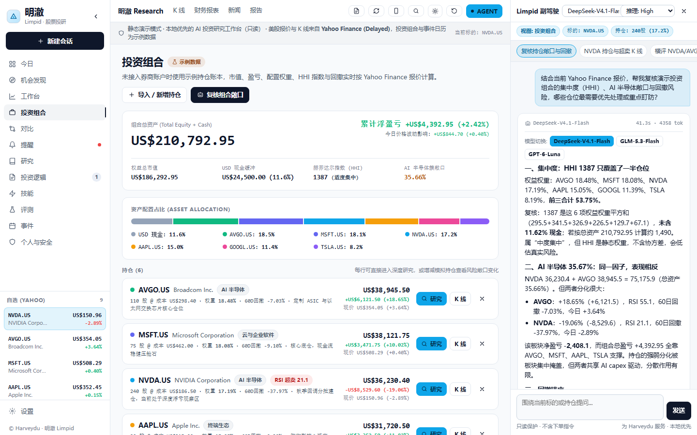
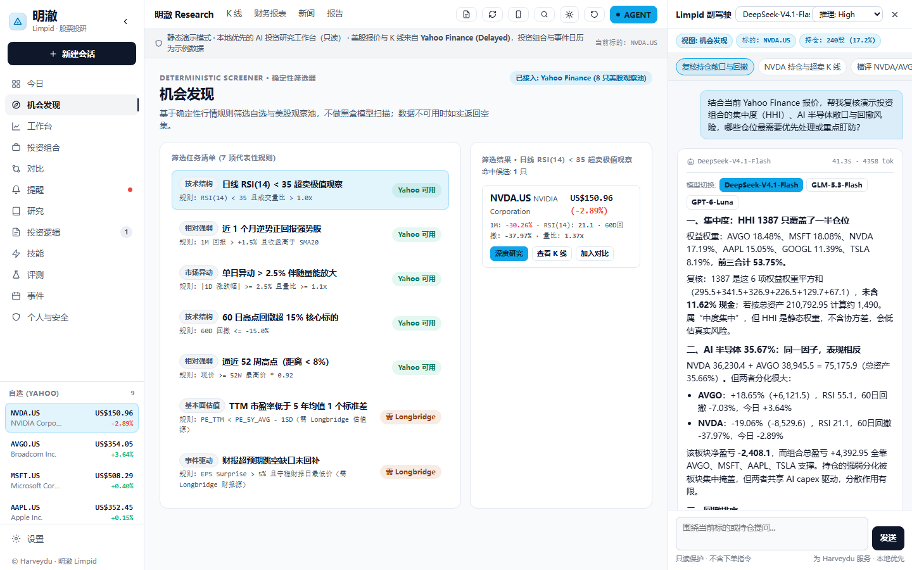
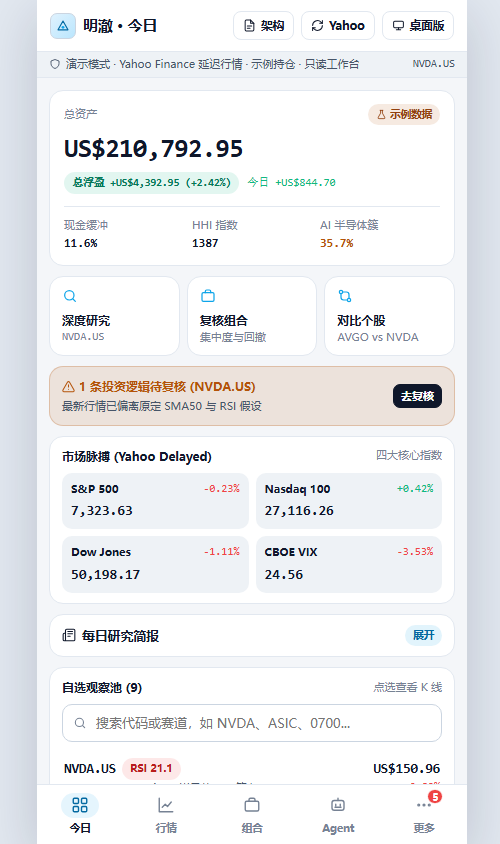
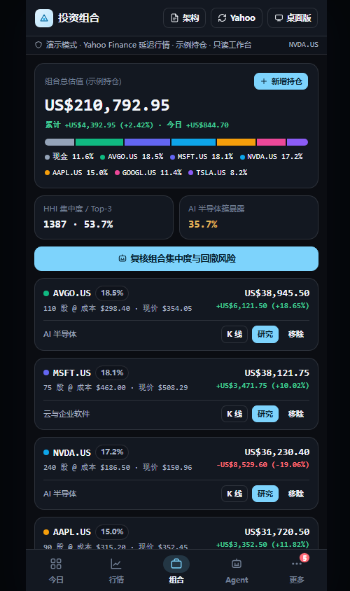

<h1 align="center">Limpid · 明澈</h1>

<p align="center"></p>

<p align="center">English · <a href="README.md">简体中文</a></p>

<p align="center">
  <strong>An AI workbench for stock investment research</strong><br />
  Market data, portfolio, research and your own judgments in one workspace, with every conclusion traceable to its evidence.
</p>

<p align="center">
  <a href="https://limpid.harveydu.top">Live demo</a> ·
  <a href="https://limpid.harveydu.top/mobile.html">Mobile</a> ·
  <a href="#product-preview">Preview</a> ·
  <a href="#core-features">Features</a> ·
  <a href="#quick-start">Quick start</a> ·
  <a href="#data-notes">Data notes</a> ·
  <a href="CHANGELOG.md">Changelog</a>
</p>

<p align="center">
  <a href="https://github.com/Luckyou-d/Limpid/actions/workflows/pr.yml"></a>
  
  
  
  
</p>

## Why Limpid

When you research a stock, prices, filings, news and your own judgments usually live in different windows. Once the research is done, what remains is often a single conclusion, with no record of what it was based on, which data has gone stale, or what would overturn it.

**Limpid keeps the whole loop in one workspace: Today → Discover → Workbench → Deep research → Investment thesis → Ongoing review.** Each step keeps its evidence, so judgments can be checked and revised.

## Product preview

<table>
  <tr>
    <td align="center"><br /><sub>Today overview · light</sub></td>
    <td align="center"><br /><sub>Today overview · dark</sub></td>
  </tr>
  <tr>
    <td align="center"><br /><sub>Workbench: charts, financials and news</sub></td>
    <td align="center"><br /><sub>Workbench · dark</sub></td>
  </tr>
  <tr>
    <td align="center"><br /><sub>Deep research: capability log and structured conclusions</sub></td>
    <td align="center"><br /><sub>Investment thesis: assumptions checked one by one</sub></td>
  </tr>
  <tr>
    <td align="center"><br /><sub>Portfolio: concentration and risk diagnostics</sub></td>
    <td align="center"><br /><sub>Discover: screening tasks with visible rules</sub></td>
  </tr>
  <tr>
    <td align="center"><br /><sub>Mobile · Today</sub></td>
    <td align="center"><br /><sub>Mobile · Portfolio · dark</sub></td>
  </tr>
</table>

## Core features

1. **Today overview**: total assets and P&L, upcoming events, market pulse and your watchlist at a glance.
2. **Discover**: screen symbols with visible rules such as RSI oversold, relative strength and drawdown.
3. **Workbench**: daily and weekly candlestick charts with EMA overlays, overview, financial statements and news.
4. **Portfolio**: position weights, HHI concentration, sector cluster exposure and per-position P&L contribution.
5. **Deep research**: runs capabilities one by one and records each result. Success, partial success and unavailable data are labelled explicitly, missing fields are never invented, and the output includes a stance, a confidence level and bull and bear arguments.
6. **Investment thesis**: saves research as trackable assumptions and checks each one against the latest market data.
7. **Compare, alerts, events, skills, evaluation**: side-by-side comparison, price and indicator alerts, a catalyst calendar, skill toggles and evaluation summaries.
8. **Agent copilot**: asks questions with the current view and symbol as context. It is read-only and has no order-placement capability.
9. **Details**: command palette (`Ctrl/⌘ + K`), light and dark themes, and a dedicated mobile interface at `/mobile.html`.

## Quick start

**Run locally** (no dependencies, no API key):

```bash
git clone https://github.com/Luckyou-d/Limpid.git
cd Limpid
python -m http.server 8788 --directory public
```

Open http://localhost:8788 . The mobile interface is at http://localhost:8788/mobile.html .

**Check**:

```bash
node scripts/smoke.mjs
```

The script runs syntax checks on all JavaScript, validates the demo data shapes, verifies page asset references, scans for leftover copy and validates the deployment config.

**Deploy to Cloudflare Workers**:

```bash
npx wrangler login
npx wrangler deploy
```

Set your own domain in `routes` inside `wrangler.jsonc`. Alternatively, connect this repository to Cloudflare Pages with `public` as the output directory.

## Project structure

| Path | Description |
|---|---|
| `public/` | Pages, styles and scripts (static, no build step) |
| `src/worker.js` | Workers entry point, handles route rewrites such as `/mobile` |
| `scripts/smoke.mjs` | Smoke checks: syntax, data, assets, leftover copy, config |
| `docs/` | Screenshots and logo |
| `.github/workflows/` | PR checks and release workflow |
| `wrangler.jsonc`, `vercel.json` | Deployment config for Cloudflare Workers and Vercel |

## Tech stack

- Vanilla JavaScript: no framework, no build step, no external CDN
- CSS variables for light and dark themes
- Cloudflare Workers (Static Assets) for hosting
- GitHub Actions for PR checks and releases

## Data notes

- Market data and charts are a built-in snapshot based on delayed Yahoo Finance data. They are not refreshed in real time.
- Portfolio, events and research reports are sample data for demonstrating the interface and analysis workflow. They are not investment advice.
- Copilot replies come from scenario-based preset content. No external language model is called.
- The project has no trading integration and cannot place orders or move funds.

## Changelog and contributing

- Release history: [CHANGELOG.md](CHANGELOG.md)
- Development guide: [CONTRIBUTING.md](CONTRIBUTING.md)

## License

Released under the [MIT License](LICENSE).
