<h1 align="center">Limpid · 明澈</h1>

<p align="center"></p>

<p align="center">English · <a href="README.md">简体中文</a></p>

<p align="center">
  <strong>An AI workbench for stock investment research</strong><br />
  Market data, portfolio, research and your own judgments in one workspace, with every conclusion traceable to its evidence.
</p>

<p align="center">
  <a href="https://limpid.harveydu.top">Live demo</a> ·
  <a href="https://limpid.harveydu.top/mobile.html">Mobile</a> ·
  <a href="#product-preview">Preview</a> ·
  <a href="#core-features">Features</a> ·
  <a href="#quick-start">Quick start</a> ·
  <a href="#data-notes">Data notes</a> ·
  <a href="CHANGELOG.md">Changelog</a>
</p>

<p align="center">
  <a href="https://github.com/Luckyou-d/Limpid/actions/workflows/pr.yml"></a>
  
  
  
  
</p>

## Why Limpid

When you research a stock, prices, filings, news and your own judgments usually live in different windows. Once the research is done, what remains is often a single conclusion, with no record of what it was based on, which data has gone stale, or what would overturn it.

**Limpid keeps the whole loop in one workspace: Today → Discover → Workbench → Deep research → Investment thesis → Ongoing review.** Each step keeps its evidence, so judgments can be checked and revised.

## Product preview

<table>
  <tr>
    <td align="center">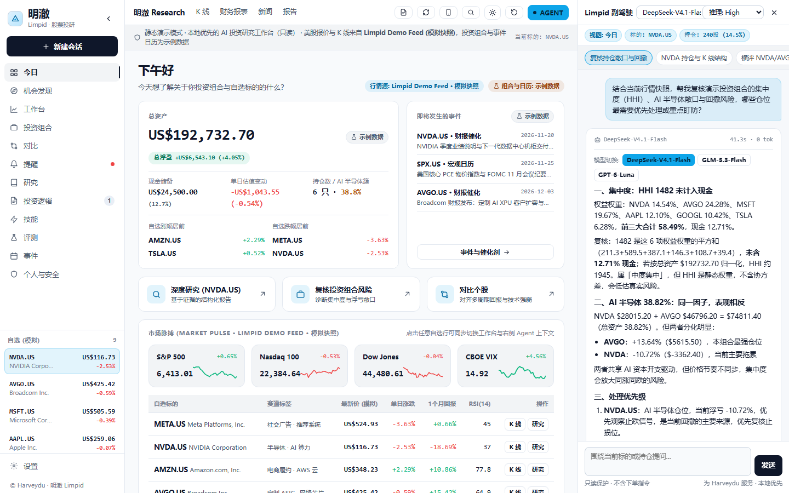<br /><sub>Today overview</sub></td>
    <td align="center"><br /><sub>Discover: screening tasks with visible rules</sub></td>
  </tr>
  <tr>
    <td align="center"><br /><sub>Workbench: candlestick chart with EMA overlays</sub></td>
    <td align="center"><br /><sub>Workbench: financial statements</sub></td>
  </tr>
  <tr>
    <td align="center">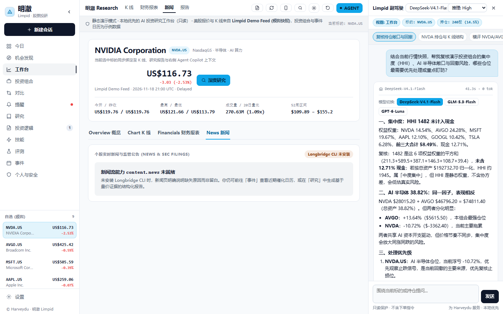<br /><sub>Workbench: news</sub></td>
    <td align="center">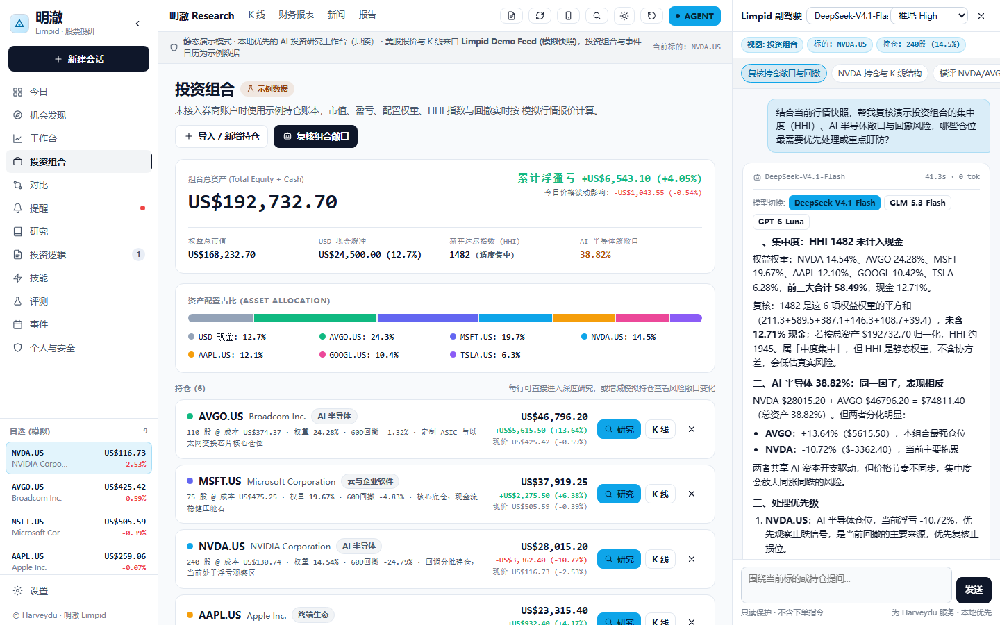<br /><sub>Portfolio: concentration and risk diagnostics</sub></td>
  </tr>
  <tr>
    <td align="center"><br /><sub>Multi-symbol comparison</sub></td>
    <td align="center">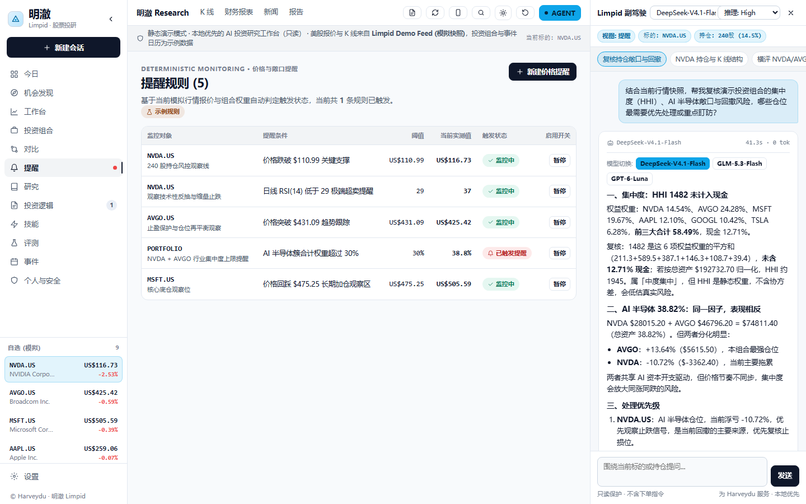<br /><sub>Alerts: price and indicator conditions</sub></td>
  </tr>
  <tr>
    <td align="center">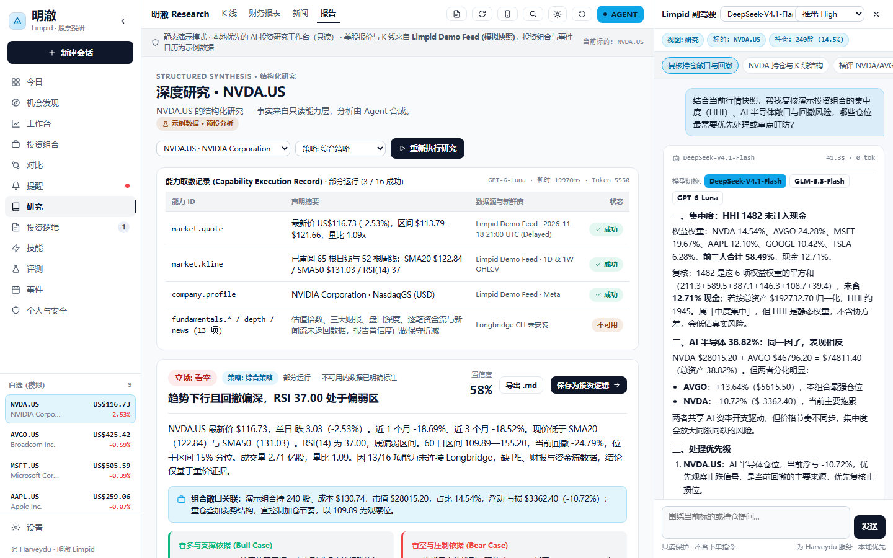<br /><sub>Deep research: capability log and structured conclusions</sub></td>
    <td align="center">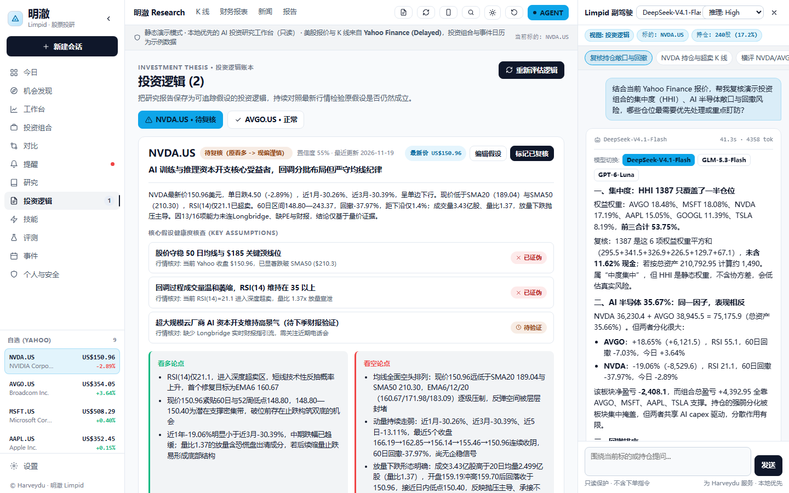<br /><sub>Investment thesis: assumptions checked one by one</sub></td>
  </tr>
  <tr>
    <td align="center">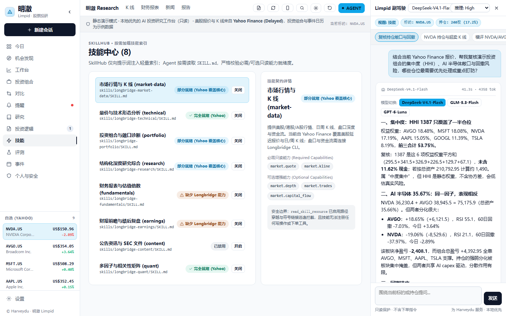<br /><sub>Skills: on-demand capability index</sub></td>
    <td align="center">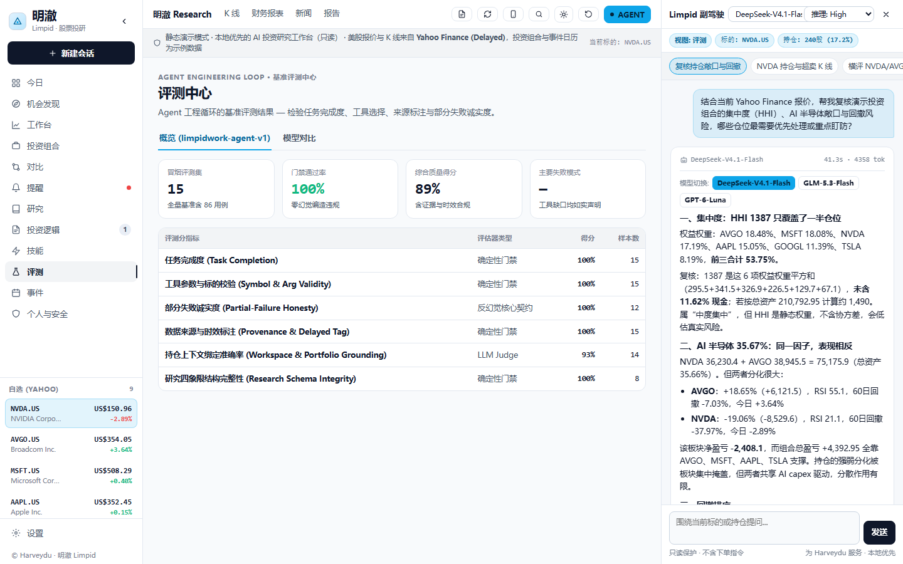<br /><sub>Evaluation: benchmark results</sub></td>
  </tr>
  <tr>
    <td align="center">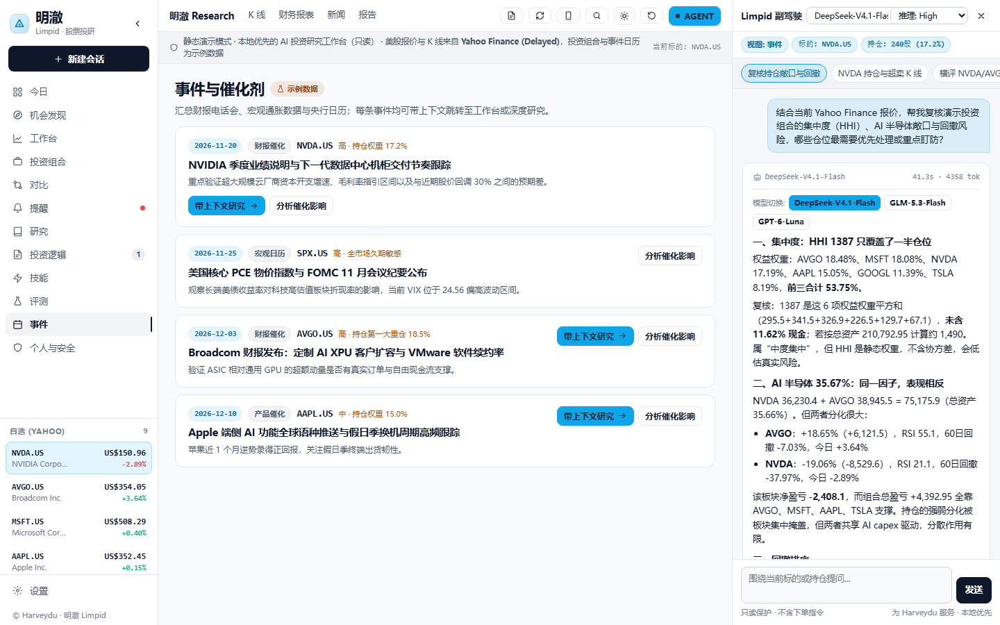<br /><sub>Events and catalyst calendar</sub></td>
    <td align="center"><br /><sub>Profile and security: read-only status and data sources</sub></td>
  </tr>
  <tr>
    <td align="center" colspan="2"><sub><b>Mobile</b></sub></td>
  </tr>
  <tr>
    <td align="center"><br /><sub>Today</sub></td>
    <td align="center">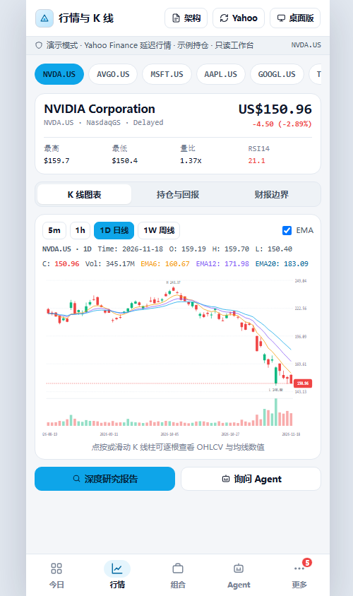<br /><sub>Workbench</sub></td>
  </tr>
  <tr>
    <td align="center">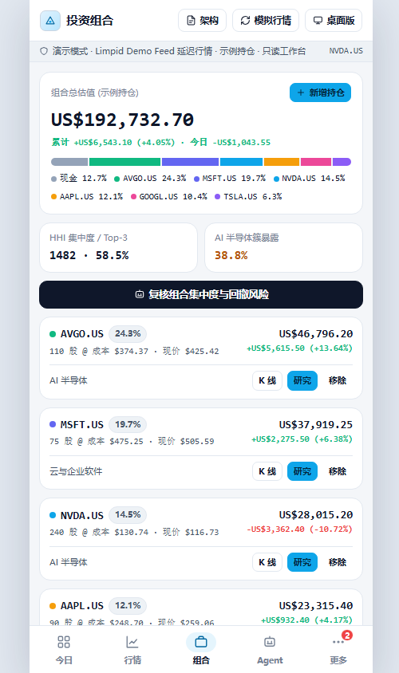<br /><sub>Portfolio</sub></td>
    <td align="center">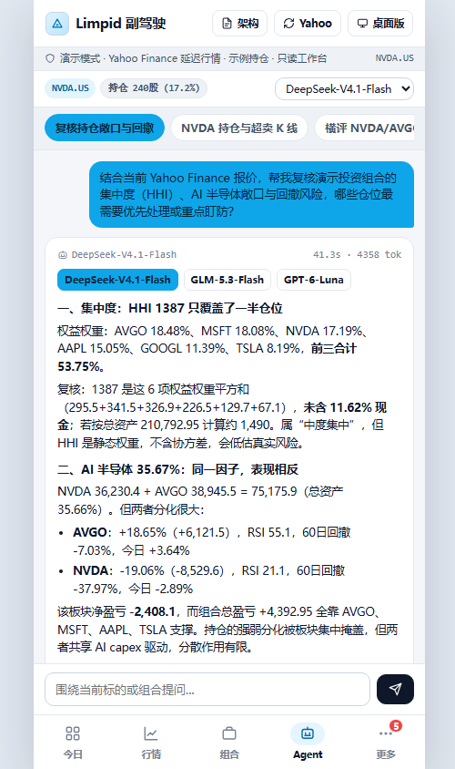<br /><sub>Agent copilot</sub></td>
  </tr>
</table>
## Core features

### 1. Today overview
The first screen you see. It summarises total assets, daily and cumulative P&L and cash weight, lists the biggest movers in your watchlist, and shows upcoming events and the market pulse (S&P 500, Nasdaq 100, Dow Jones and VIX). Clicking any watchlist symbol opens it in the workbench and updates the copilot context to match.

### 2. Discover
Screening rules organised as a task catalogue. Each rule states its condition in plain terms, for example "RSI(14) < 35 with volume ratio > 1.0x", "drawdown from 60-day high beyond 15%" or "price within 8% of the 52-week high". Rules are grouped into technical structure, relative strength, market moves, fundamental valuation and event-driven, and each one lists the data sources it requires.

### 3. Workbench
A deep view of a single symbol with three tabs:
- **Chart**: daily and weekly candlesticks with EMA(6, 12, 20) overlays, OHLC and volume.
- **Financials**: three financial statements and valuation multiples (P/E, P/B, EV/EBITDA). These depend on the Longbridge CLI or a paid data source. Until one is connected, the page shows the capability as "not ready" instead of leaving a blank.
- **News**: company news and regulatory filings. This also depends on the Longbridge news capability. When it is not ready, the page explains why and points you to the Events calendar.

### 4. Deep research
Pick a symbol and a strategy, and the system runs research capability by capability, recording each result as success, partial success or unavailable, together with its source and freshness. The output is a structured conclusion: a stance (bullish, bearish or needs review), a confidence level, bull and bear arguments, catalysts and risks, and how the symbol relates to your current portfolio exposure. You can export it as Markdown or save it as an investment thesis in one step.

### 5. Investment thesis
Saves research conclusions as trackable assumptions. Each assumption carries a status (intact, pending or broken). The latest market data is checked against every assumption, and a broken one prompts a review. Each re-evaluation records the time, the model used and what changed, so you can see how a judgment evolved.

### 6. Portfolio
Shows position weights, cost, last price, P&L and sector cluster breakdown. It computes HHI concentration, the top-three share, and combined weights for clusters such as AI semiconductors. Entry points such as "Review concentration and drawdown risk" hand the question straight to the copilot. Positions can be added or removed, which only changes the local demo data.

### 7. Compare
Places several symbols side by side, by default NVDA, AVGO, MSFT and AAPL, and lets you add or remove them. It compares single-day moves, period returns and a normalised relative-performance curve, which makes strength differences easy to see.

### 8. Alerts
Conditional alerts on a symbol, including price below or above a level, RSI below a threshold and cluster weight above a limit. Each alert can be switched on or off and carries a note, for example "risk watch level for a 240-share position".

### 9. Events and catalysts
A dated calendar of earnings, macro releases and product catalysts. Each entry shows its impact on the portfolio (for example "position weight 17.2%") and the points to verify, so you can prepare in advance.

### 10. Skills
An index of the capabilities the agent can use. Each skill lists its required and optional capabilities and a readiness state (fully ready, partially ready, missing data source or disabled), and can be toggled. Each skill also states its safety boundary, for example that it may only read approved paths and cannot write or execute anything.

### 11. Evaluation
Benchmark results for the agent: task completion, tool-argument validation, honesty when part of a task fails, source labelling, grounding accuracy against the workspace and portfolio, and research schema integrity. For the same task you can compare how different models performed on latency and token usage.

### 12. Agent copilot
A persistent panel on the right. Its context follows the current page and symbol and shows the view, the symbol and portfolio position. It offers scenario-based quick prompts, such as reviewing portfolio concentration, checking NVDA's position against its oversold chart, or comparing NVDA with AVGO. You can switch models and reasoning level, and each reply shows the model used and the response time. The copilot is read-only and has no order-placement instructions.

### 13. Productivity and mobile
- **Command palette**: press `Ctrl/⌘ + K` to jump to a page or a symbol.
- **Themes**: switch between light and dark with one click.
- **Mobile interface** (`/mobile.html`): covers the four main entry points, Today, Workbench, Portfolio and Copilot, in a single-column layout designed for phones.

### 14. Profile and security
Shows the read-only boundary and data-source status: the number of trading capabilities (zero), the market data connector and snapshot time, where state is stored locally, and how missing data is displayed. You can refresh the market snapshot here or open the connection and model settings.
## Quick start

**Run locally** (no dependencies, no API key):

```bash
git clone https://github.com/Luckyou-d/Limpid.git
cd Limpid
python -m http.server 8788 --directory public
```

Open http://localhost:8788 . The mobile interface is at http://localhost:8788/mobile.html .

**Check**:

```bash
node scripts/smoke.mjs
```

The script runs syntax checks on all JavaScript, validates the demo data shapes, verifies page asset references, scans for leftover copy and validates the deployment config.

**Deploy to Cloudflare Workers**:

```bash
npx wrangler login
npx wrangler deploy
```

Set your own domain in `routes` inside `wrangler.jsonc`. Alternatively, connect this repository to Cloudflare Pages with `public` as the output directory.

## Project structure

| Path | Description |
|---|---|
| `public/` | Pages, styles and scripts (static, no build step) |
| `src/worker.js` | Workers entry point, handles route rewrites such as `/mobile` |
| `scripts/smoke.mjs` | Smoke checks: syntax, data, assets, leftover copy, config |
| `docs/` | Screenshots and logo |
| `.github/workflows/` | PR checks and release workflow |
| `wrangler.jsonc`, `vercel.json` | Deployment config for Cloudflare Workers and Vercel |


## Data notes

- Market data and charts are a built-in snapshot based on delayed Yahoo Finance data. They are not refreshed in real time.
- Portfolio, events and research reports are sample data for demonstrating the interface and analysis workflow. They are not investment advice.
- Copilot replies come from scenario-based preset content. No external language model is called.
- The project has no trading integration and cannot place orders or move funds.

## Changelog and contributing

- Release history: [CHANGELOG.md](CHANGELOG.md)
- Development guide: [CONTRIBUTING.md](CONTRIBUTING.md)

## License

Released under the [MIT License](LICENSE).
