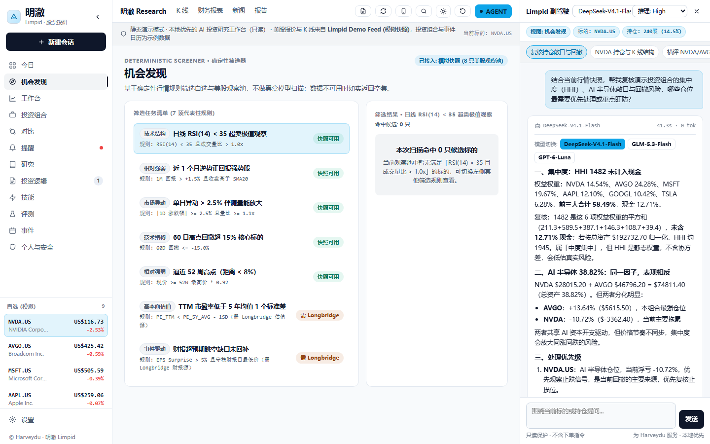
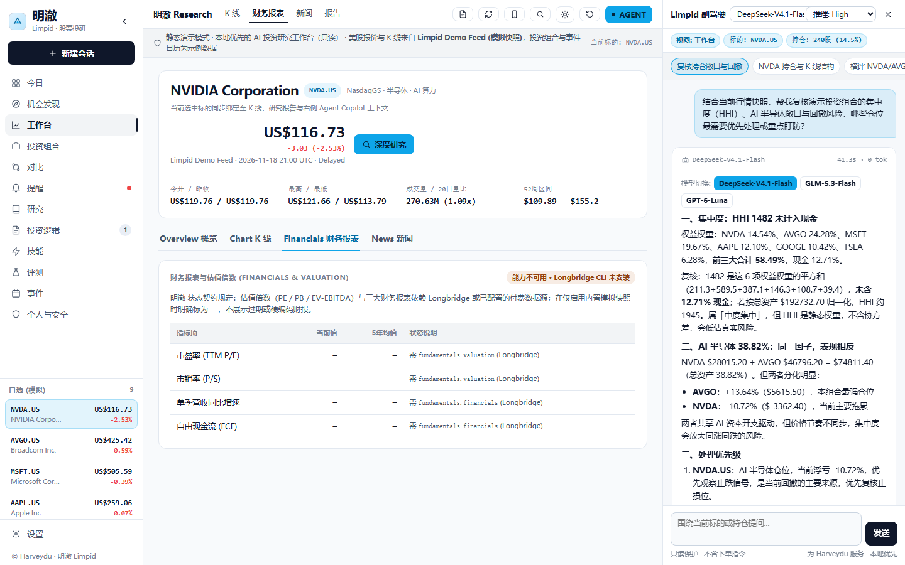
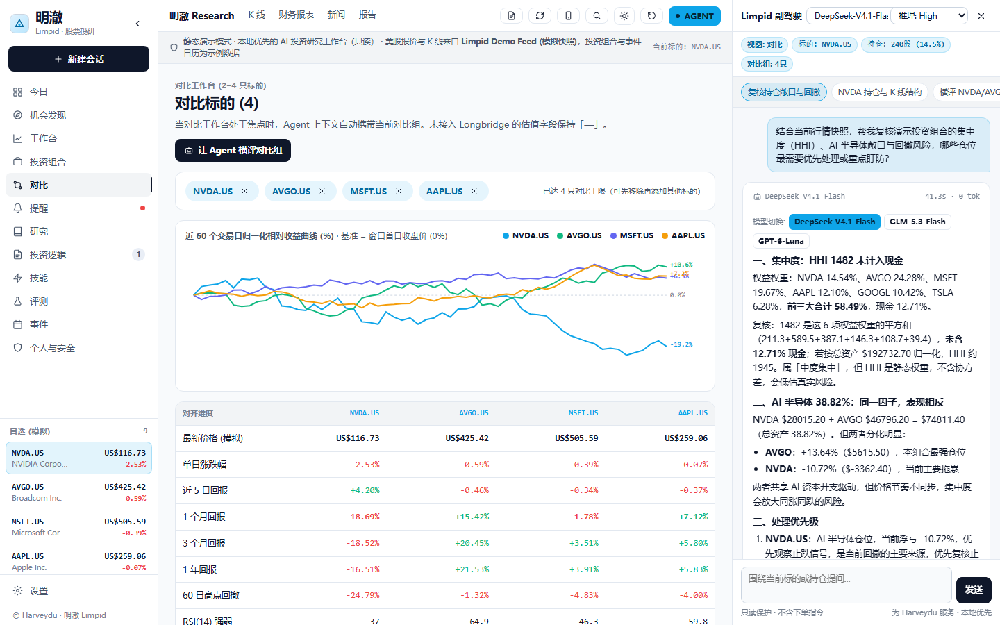
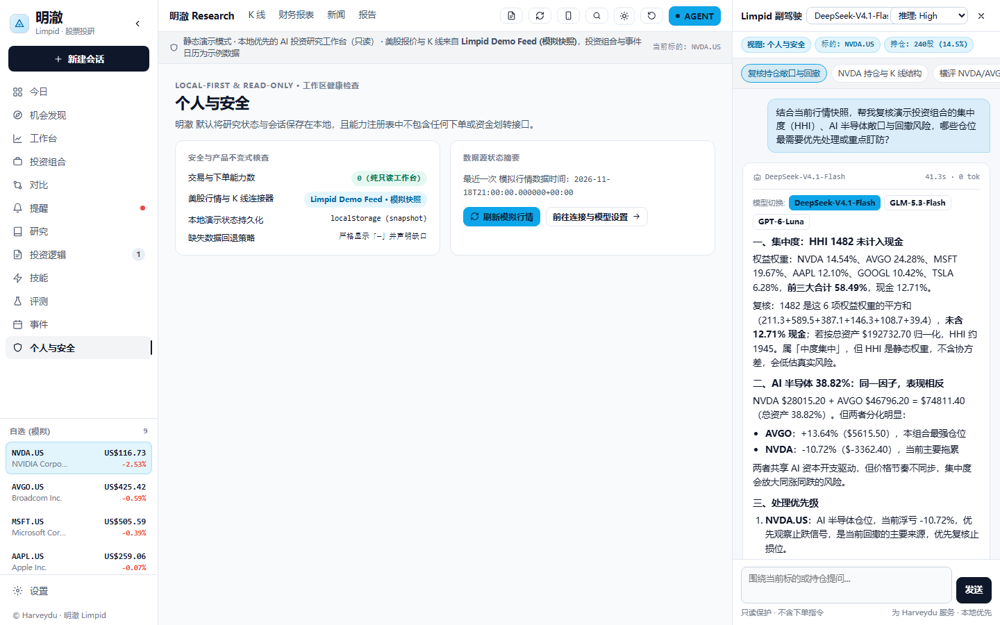
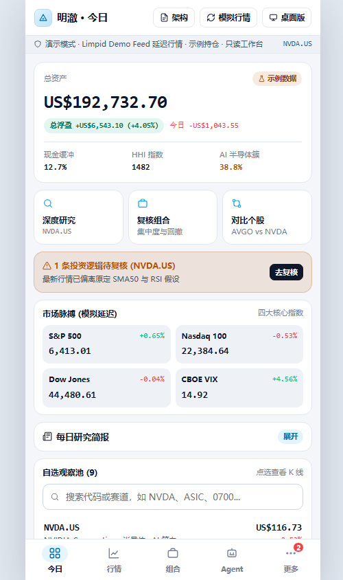

<h1 align="center">明澈 · Limpid</h1>

<p align="center"></p>

<p align="center"><a href="README.en.md">English</a> · 简体中文</p>

<p align="center">
  <strong>面向股票投资研究的 AI 工作台</strong><br />
  把行情、组合、研究与判断放在同一个工作区里，让每一个结论都能回溯到依据。
</p>

<p align="center">
  <a href="https://limpid.harveydu.top">在线演示</a> ·
  <a href="https://limpid.harveydu.top/mobile">移动端</a> ·
  <a href="#产品预览">产品预览</a> ·
  <a href="#核心功能">核心功能</a> ·
  <a href="#快速开始">快速开始</a> ·
  <a href="#数据源与能力边界">数据源</a> ·
  <a href="CHANGELOG.md">更新日志</a>
</p>

<p align="center">
  <a href="https://github.com/Luckyou-d/Limpid/actions/workflows/pr.yml"></a>
  
  
  
  
</p>

## 为什么做明澈

研究一只股票时，价格、财报、新闻和判断通常散落在不同窗口里。研究结束后，留下的往往只是一句结论，却不知道当时依据什么、哪些数据已经过时、什么变化会推翻它。

**明澈把研究放回同一个工作区：今日总览 → 机会发现 → 工作台 → 深度研究 → 投资逻辑 → 持续复核。** 每一步都保留依据，让判断可以被检查，也可以被修正。

## 产品预览

<table>
  <tr>
    <td align="center"><br /><sub>今日总览</sub></td>
    <td align="center"><br /><sub>机会发现：可见规则的筛选任务</sub></td>
  </tr>
  <tr>
    <td align="center"><br /><sub>工作台：K 线与 EMA 叠加</sub></td>
    <td align="center"><br /><sub>工作台：财务报表</sub></td>
  </tr>
  <tr>
    <td align="center"><br /><sub>工作台：新闻</sub></td>
    <td align="center"><br /><sub>投资组合：集中度与风险诊断</sub></td>
  </tr>
  <tr>
    <td align="center"><br /><sub>多标的对比</sub></td>
    <td align="center"><br /><sub>提醒：价格与指标条件</sub></td>
  </tr>
  <tr>
    <td align="center"><br /><sub>深度研究：能力执行记录与结构化结论</sub></td>
    <td align="center"><br /><sub>投资逻辑：假设逐条核对</sub></td>
  </tr>
  <tr>
    <td align="center"><br /><sub>技能中心：按需加载的能力索引</sub></td>
    <td align="center"><br /><sub>评测中心：基准评测结果</sub></td>
  </tr>
  <tr>
    <td align="center"><br /><sub>事件与催化剂日历</sub></td>
    <td align="center"><br /><sub>个人与安全：只读与数据源状态</sub></td>
  </tr>
  <tr>
    <td align="center" colspan="2"><sub><b>移动端</b></sub></td>
  </tr>
  <tr>
    <td align="center"><br /><sub>今日</sub></td>
    <td align="center"><br /><sub>工作台</sub></td>
  </tr>
  <tr>
    <td align="center"><br /><sub>组合</sub></td>
    <td align="center"><br /><sub>Agent 副驾驶</sub></td>
  </tr>
</table>

## 核心功能

### 1. 今日总览
进入产品后的第一屏。汇总组合总资产、当日与累计盈亏、现金占比，列出自选中的涨跌幅前列，并展示即将发生的事件与市场脉搏（标普、纳指、道指、VIX）。点击自选中的任一标的，即可跳转到工作台，并同步到右侧副驾驶的上下文中。

### 2. 机会发现
以任务目录的形式组织筛选规则，每条规则都写明判定条件，例如"RSI(14) < 35 且量比 > 1.0x""60 日回撤超过 15%""现价逼近 52 周高点"。规则按技术结构、相对强弱、市场异动、基本面估值、事件驱动等类别归档，并标注所需的数据源。

### 3. 工作台
单个标的的深度视图，包含三个标签：
- **K 线**：日线与周线切换，支持 EMA(6、12、20) 叠加，显示 OHLC 与成交量。
- **财务报表**：展示三大报表与估值倍数（PE、PB、EV/EBITDA）。这些数据依赖 Longbridge CLI 或付费数据源，未接入时页面明确显示"能力未就绪"，而不是留白。
- **新闻**：展示个股新闻与监管公告。同样依赖 Longbridge 新闻能力，未就绪时说明缺失原因，并引导到"事件"页查看催化日历。

### 4. 深度研究
选择标的与策略后，系统按能力逐项执行研究，并记录每一项的结果：成功、部分成功或不可用，同时标注数据来源与时效。最终输出结构化结论，包括立场（看多、看空或待复核）、置信度、多头与空头论据、催化因素与风险点，并说明与当前组合敞口的关联。结论可导出为 Markdown，也可以一键保存为投资逻辑。

### 5. 投资逻辑
把研究结论保存为可追踪的假设。每条假设都有状态标记（成立、待验证或已证伪），系统会用最新行情逐条核对，发现被证伪时提示复核。每次重新评估都会记录时间、所用模型与结论变化，方便回看判断是如何演变的。

### 6. 投资组合
展示持仓的权重、成本价、现价、盈亏和行业簇分布，计算 HHI 集中度、前三大持仓占比，以及 AI 半导体等簇的合计权重。页面提供"复核组合集中度与回撤风险"等入口，可以直接交给副驾驶分析。持仓可以新增和移除，只影响本地演示数据。

### 7. 对比
默认并排比较 NVDA、AVGO、MSFT、AAPL 等标的，可自行增减。对比维度包括单日涨跌幅、区间回报，以及归一化后的相对走势曲线，便于观察强弱分化。

### 8. 提醒
为标的设置条件提醒，支持价格跌破或突破、RSI 低于阈值、簇权重超限等类型。每条提醒可单独开关，并附有说明，例如"240 股持仓的风控观察线"。

### 9. 事件与催化剂
按日期列出财报、宏观数据、产品发布等催化剂，标注对组合的影响权重（例如"持仓权重 17.2%"），并列出需要验证的要点，便于提前准备。

### 10. 技能中心
以能力索引的形式展示 Agent 可用的技能。每项技能列出必需能力与可选能力，显示就绪状态（完全就绪、部分就绪、缺少数据源、已禁用），并可开关。技能说明中写明安全边界，例如只能读取指定路径、不能写入或执行操作。

### 11. 评测中心
展示 Agent 的基准评测结果，包括任务完成度、工具参数校验、部分失败时的诚实度、数据来源标注、上下文绑定准确率和研究结构完整性。同一任务下还能对比不同模型的耗时与用量。

### 12. Agent 副驾驶
右侧常驻面板，上下文随当前页面和标的变化，显示视图、标的与持仓信息。提供场景化快捷问题，例如复核组合集中度、查看 NVDA 持仓与超卖 K 线、对比 NVDA 与 AVGO。可切换模型和推理强度，回复会标注所用模型与耗时。副驾驶只读，不包含下单指令。

### 13. 效率与移动端
- **命令面板**：按 `Ctrl/⌘ + K` 快速跳转页面或标的。
- **主题**：浅色与深色主题一键切换。
- **移动端**（`/mobile.html`）：覆盖今日、工作台、组合、副驾驶四个主要入口，布局为单列，适合手机浏览。

### 14. 个人与安全
展示只读边界与数据源状态：交易类能力数量为 0，行情连接器与快照时间，本地保存的位置，以及数据缺失时的显示策略。可以在此刷新行情快照，或前往连接与模型设置。

## 快速开始

**本地运行**（无需安装依赖，无需 API Key）：

```bash
git clone https://github.com/Luckyou-d/Limpid.git
cd Limpid
python -m http.server 8788 --directory public
```

打开 http://localhost:8788 ，移动端界面位于 http://localhost:8788/mobile.html 。

**检查**：

```bash
node scripts/smoke.mjs
```

脚本会对所有 JavaScript 做语法检查、校验演示数据结构、检查页面资源引用、扫描残留文案，并校验部署配置。

**部署到 Cloudflare Workers**：

```bash
npx wrangler login
npx wrangler deploy
```

在 `wrangler.jsonc` 的 `routes` 中填写自己的域名即可绑定。也可以使用 Cloudflare Pages 连接本仓库，输出目录设为 `public`。

## 项目结构

| 路径 | 说明 |
|---|---|
| `public/` | 页面、样式与脚本（纯静态，无构建步骤） |
| `src/worker.js` | Workers 入口，负责 `/mobile` 等路由改写 |
| `scripts/smoke.mjs` | 冒烟检查（语法、数据、资源、残留、配置） |
| `docs/` | 截图与 Logo |
| `.github/workflows/` | PR 检查与版本发布流程 |
| `wrangler.jsonc`、`vercel.json` | Cloudflare Workers 与 Vercel 部署配置 |

## 数据源与能力边界

明澈是**离线可运行的演示工作台**：不连接真实行情，也不调用外部大模型。价格、K 线与研究报告由固定随机种子的脚本生成，同一份代码在任何机器上产出一致的结果。完整矩阵见 [数据源说明](docs/data-sources.md)。

| 数据源 | 状态 | 覆盖范围 |
|---|---|---|
| Limpid Demo Feed | 已启用 | 8 只美股观察池的模拟价格、日/周 K 线、公司简称 |
| Longbridge OpenAPI / CLI | 未安装 | 港股 / A 股实时深度、三大报表、新闻公告、券商持仓 |
| Massive | 未配置 | 美股后备数据源 |
| 模型运行时 | 预设内容 | 副驾驶回复与研究结论为场景化预设文本 |

**缺失数据时**：

- 能力不可用时说明原因，例如「Longbridge CLI 未安装」，不留白、不编造。
- 财务与估值字段显示 `—`，不使用估算值或历史数据顶替。
- 页面加载不发起外部请求；「重新载入快照」只读取内置数据。
- 组合、事件、研究与提醒页面均带「示例数据」标记，示例不会冒充已连接账户。

**重新生成模拟数据**：

```bash
node scripts/generate-demo-data.mjs   # 固定种子，产出确定一致的行情与叙述文本
node scripts/smoke.mjs                # 校验语法、数据结构、文本与快照的一致性
```

所有指标（SMA、EMA、RSI、回撤、区间回报）均由同一条价格序列计算，因此图表、表格与文字中的数字始终相互吻合。

## 更新日志与贡献

- 版本记录见 [CHANGELOG.md](CHANGELOG.md)。
- 参与开发请阅读 [CONTRIBUTING.md](CONTRIBUTING.md)。

## 许可证

本项目基于 [MIT License](LICENSE) 开源。
