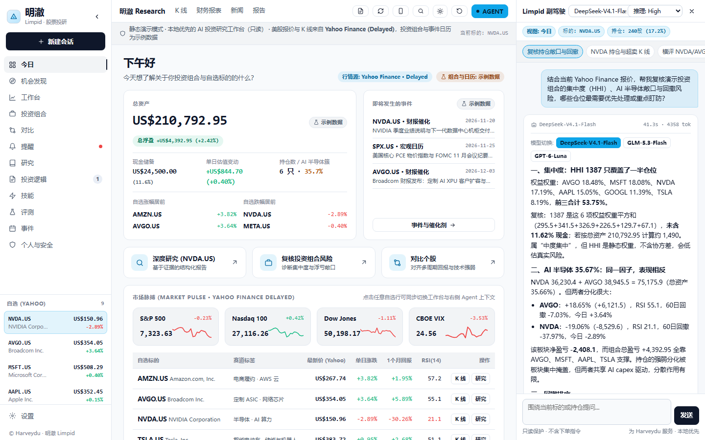
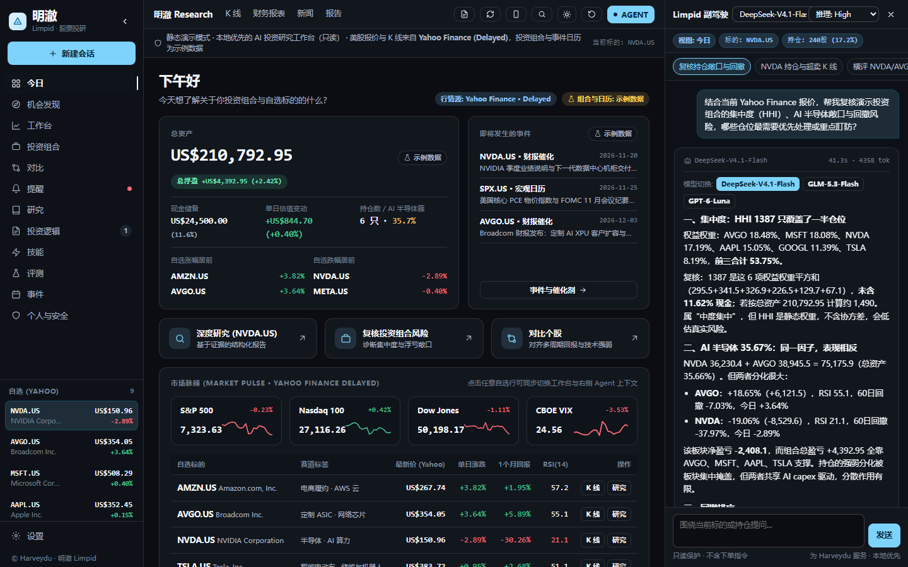
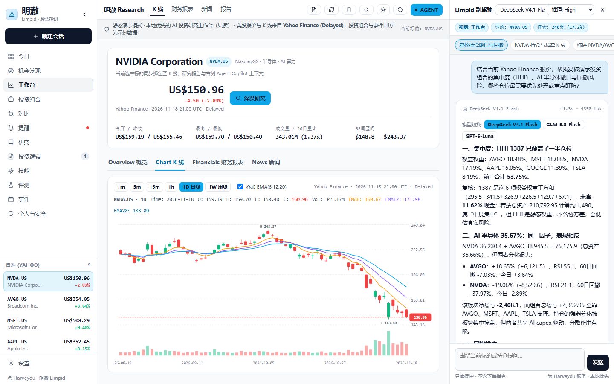
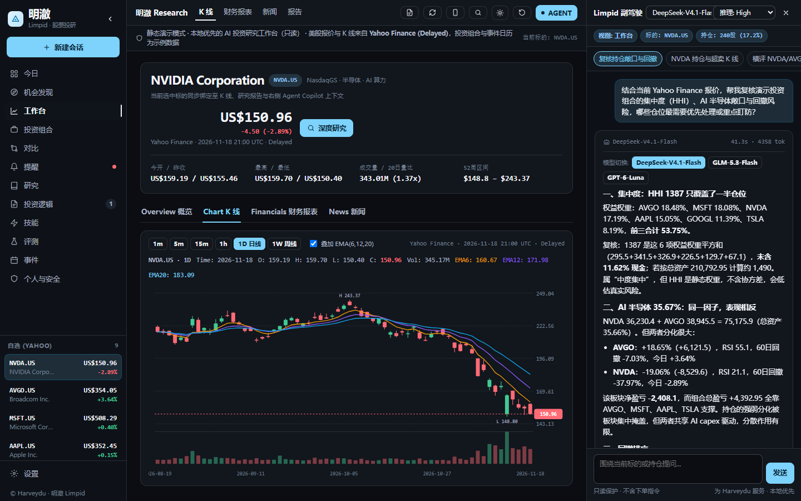
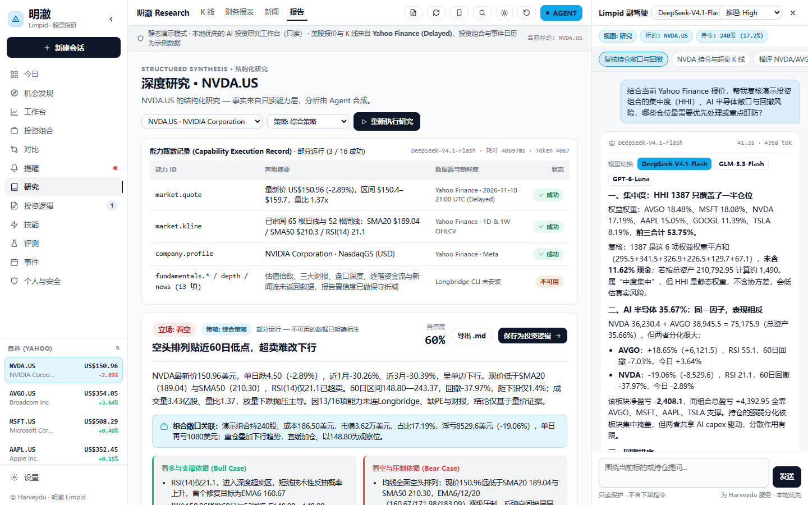
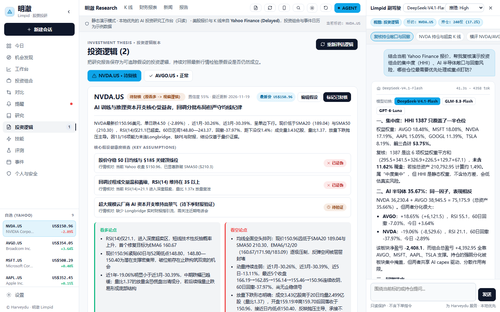
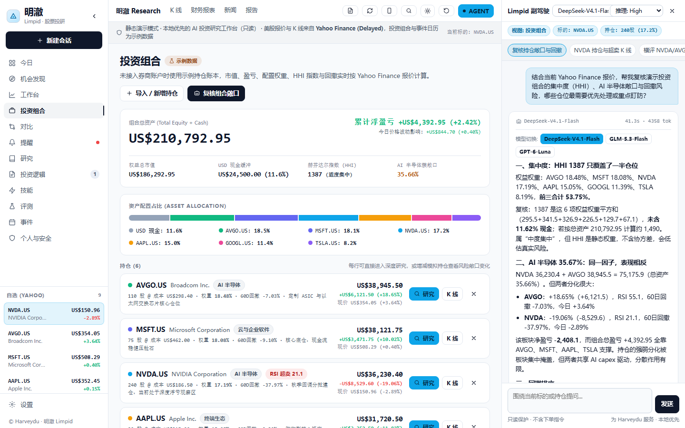
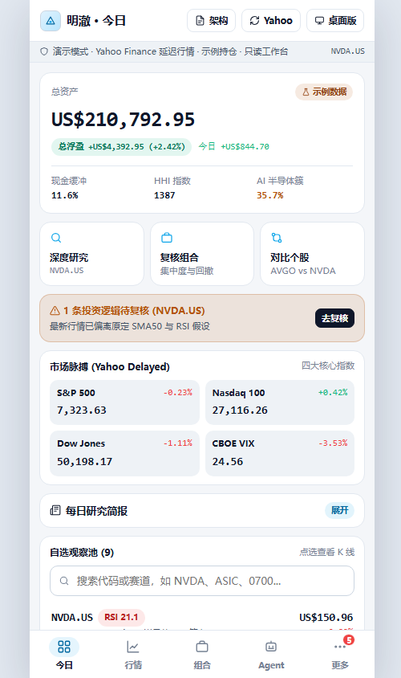
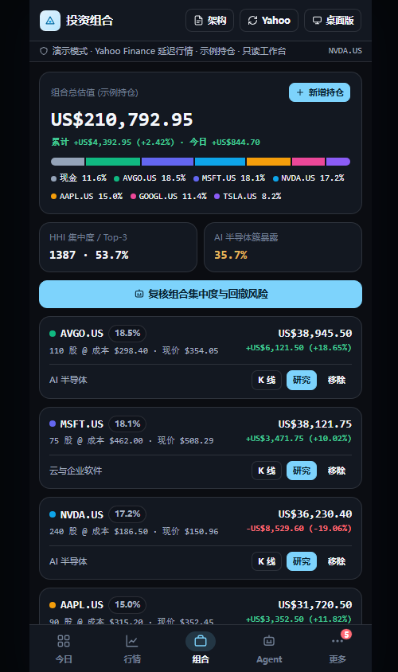

<h1 align="center">明澈 · Limpid</h1>

<p align="center"></p>

<p align="center"><a href="README.en.md">English</a> · 简体中文</p>

<p align="center">
  <strong>面向股票投资研究的 AI 工作台</strong><br />
  把行情、组合、研究与判断放在同一个工作区里，让每一个结论都能回溯到依据。
</p>

<p align="center">
  <a href="https://limpid.harveydu.top">在线演示</a> ·
  <a href="https://limpid.harveydu.top/mobile">移动端</a> ·
  <a href="#产品预览">产品预览</a> ·
  <a href="#核心功能">核心功能</a> ·
  <a href="#快速开始">快速开始</a> ·
  <a href="#数据说明">数据说明</a> ·
  <a href="CHANGELOG.md">更新日志</a>
</p>

<p align="center">
  <a href="https://github.com/Luckyou-d/Limpid/actions/workflows/pr.yml"></a>
  
  
  
  
</p>

## 为什么做明澈

研究一只股票时，价格、财报、新闻和判断通常散落在不同窗口里。研究结束后，留下的往往只是一句结论，却不知道当时依据什么、哪些数据已经过时、什么变化会推翻它。

**明澈把研究放回同一个工作区：今日总览 → 机会发现 → 工作台 → 深度研究 → 投资逻辑 → 持续复核。** 每一步都保留依据，让判断可以被检查，也可以被修正。

## 产品预览

<table>
  <tr>
    <td align="center"><br /><sub>今日总览 · 浅色</sub></td>
    <td align="center"><br /><sub>今日总览 · 深色</sub></td>
  </tr>
  <tr>
    <td align="center"><br /><sub>工作台：K 线、财务与新闻</sub></td>
    <td align="center"><br /><sub>工作台 · 深色</sub></td>
  </tr>
  <tr>
    <td align="center"><br /><sub>深度研究：能力执行记录与结构化结论</sub></td>
    <td align="center"><br /><sub>投资逻辑：假设逐条核对</sub></td>
  </tr>
  <tr>
    <td align="center"><br /><sub>投资组合：集中度与风险诊断</sub></td>
    <td align="center"><br /><sub>机会发现：可见规则的筛选任务</sub></td>
  </tr>
  <tr>
    <td align="center"><br /><sub>移动端 · 今日</sub></td>
    <td align="center"><br /><sub>移动端 · 组合 · 深色</sub></td>
  </tr>
</table>

## 核心功能

1. **今日总览**：组合总资产与盈亏、即将发生的事件、市场脉搏、自选标的一览。
2. **机会发现**：用可见规则筛选标的，例如 RSI 超卖、相对强弱、回撤等，规则公开透明。
3. **工作台**：K 线（日线、周线，支持 EMA 叠加）、概览、财务报表与新闻。
4. **投资组合**：持仓权重、HHI 集中度、行业簇敞口、单只盈亏贡献。
5. **深度研究**：按能力逐项执行并记录结果。成功、部分成功、不可用都会明确标注，不编造缺失数据，最终输出立场、置信度与多空论据。
6. **投资逻辑**：把研究保存为可追踪的假设，并对照最新行情逐条检验是否仍然成立。
7. **对比、提醒、事件、技能、评测**：多标的横向对比，价格与指标提醒，催化剂日历，技能开关与状态，评测结果汇总。
8. **Agent 副驾驶**：结合当前视图和标的上下文提问，只读，不包含下单能力。
9. **体验细节**：命令面板（`Ctrl/⌘ + K`）、浅色与深色主题、独立的移动端界面（`/mobile`）。

## 快速开始

**本地运行**（无需安装依赖，无需 API Key）：

```bash
git clone https://github.com/Luckyou-d/Limpid.git
cd Limpid
python -m http.server 8788 --directory public
```

打开 http://localhost:8788 ，移动端界面位于 http://localhost:8788/mobile.html 。

**检查**：

```bash
node scripts/smoke.mjs
```

脚本会对所有 JavaScript 做语法检查、校验演示数据结构、检查页面资源引用、扫描残留文案，并校验部署配置。

**部署到 Cloudflare Workers**：

```bash
npx wrangler login
npx wrangler deploy
```

在 `wrangler.jsonc` 的 `routes` 中填写自己的域名即可绑定。也可以使用 Cloudflare Pages 连接本仓库，输出目录设为 `public`。

## 项目结构

| 路径 | 说明 |
|---|---|
| `public/` | 页面、样式与脚本（纯静态，无构建步骤） |
| `src/worker.js` | Workers 入口，负责 `/mobile` 等路由改写 |
| `scripts/smoke.mjs` | 冒烟检查（语法、数据、资源、残留、配置） |
| `docs/` | 截图与 Logo |
| `.github/workflows/` | PR 检查与版本发布流程 |
| `wrangler.jsonc`、`vercel.json` | Cloudflare Workers 与 Vercel 部署配置 |

## 技术栈

- 原生 JavaScript，无框架、无构建步骤、无外部 CDN
- CSS 变量实现浅色与深色主题
- Cloudflare Workers（Static Assets）部署
- GitHub Actions 进行 PR 检查与发布

## 数据说明

- 行情与 K 线为内置快照，基于 Yahoo Finance 延迟数据整理，不会实时刷新。
- 组合、事件、研究报告均为示例数据，仅用于展示界面与分析流程，不构成投资建议。
- 副驾驶的回复来自场景化的预设内容，不调用外部大模型。
- 项目不接入交易接口，不会下单或转移资金。

## 更新日志与贡献

- 版本记录见 [CHANGELOG.md](CHANGELOG.md)。
- 参与开发请阅读 [CONTRIBUTING.md](CONTRIBUTING.md)。

## 许可证

本项目基于 [MIT License](LICENSE) 开源。
